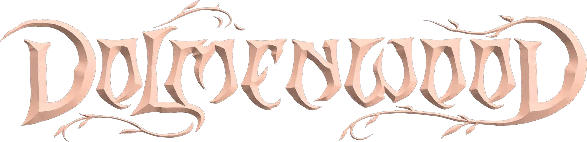

# Dolmenwood

The official [Dolmenwood](https://necroticgnome.com/) game system for Foundry Virtual Tabletop, from Necrotic Gnome. It supports Foundry VTT v13 and v14.

## Installation

In Foundry's setup screen, open **Game Systems → Install System** and search for **Dolmenwood**, or paste this manifest URL:

```
https://github.com/NecroticGnome/dolmenwood-foundry-system/releases/latest/download/system.json
```

## Features

**Characters and creatures**
- Adventurer sheets for every kindred and class, with skills, saves, encumbrance (by coin weight or by slots), and runes, glamours and spells.
- Creature sheets with attacks, morale and saves, plus sheets for horses and vehicles.
- Kindreds and Classes compendiums, ready to drag onto a sheet.
- A creature importer that turns a pasted stat block into a Creature actor.

**At the table**
- A combat tracker built for Dolmenwood: group initiative by side, combat declarations (spells, fleeing, and the optional charge and parry rules), morale checks, and initiative that can be kept, reset or re-rolled each round.
- Attack and damage rolls, with saves and damage applied from chat.
- A dungeon tracker for turns, rests and light sources, with wandering encounter checks.
- A calendar with Dolmenwood's months, unseasons and weather.
- A party viewer to see the whole company at a glance.
- A dozen colour themes inspired by the books, plus a high-contrast theme, which can also recolour Foundry's own interface.

**Free content**
- The **Dolmenwood Quick-Start** adventure, *The Weaver & the Redcaps*.
- The Dolmenwood player map, and a preview of the Player Hex Map.

## The full setting

The **Dolmenwood Premium Game** module, from [Necrotic Gnome](https://necroticgnome.com/), adds the Player's Book, Campaign Book, Monster Book and Maps Book as Foundry content: the rules and setting as journals, every creature as an actor, the books' items, spells and tables, and an interactive Player Hex Map linked to the wood's contents.

## Languages

English and Polish.

## Converting an OSE world

There are two macros in the `scripts` folder that export your OSE world content and import it into a Dolmenwood world.

1. In your OSE world, add and run [the export macro](https://github.com/NecroticGnome/dolmenwood-foundry-system/blob/main/scripts/ose-export-macro.js). It downloads a `.json` file.
2. In your Dolmenwood world, add and run [the import macro](https://github.com/NecroticGnome/dolmenwood-foundry-system/blob/main/scripts/ose-import-macro.js), and choose that file.

This converts the actors and items in your world to the Dolmenwood format, and imports its scenes and journals.

- The export only includes what's in your world, **not compendiums**. Import any compendium content you want to keep before exporting.
- Image paths are kept as they are, so removing the OSE system or its assets breaks the portraits and tokens of imported actors.

## Bugs and feedback

Report problems on the [issue tracker](https://github.com/NecroticGnome/dolmenwood-foundry-system/issues).
