# How to use this system

## General

This system implements the Dolmenwood rules for Foundry VTT. It includes the Kindreds and Classes compendiums and the free Quick-Start adventure. The [**Dolmenwood Premium Game**](https://foundryvtt.com/packages/dolmenwood-premiumgame) module adds the full setting: the books' journals, creatures, items, spells and roll tables.

Most of the Referee's tools are on the **Dolmenwood toolbar** in the scene controls on the left: the calendar, the dungeon tracker and the party viewer.

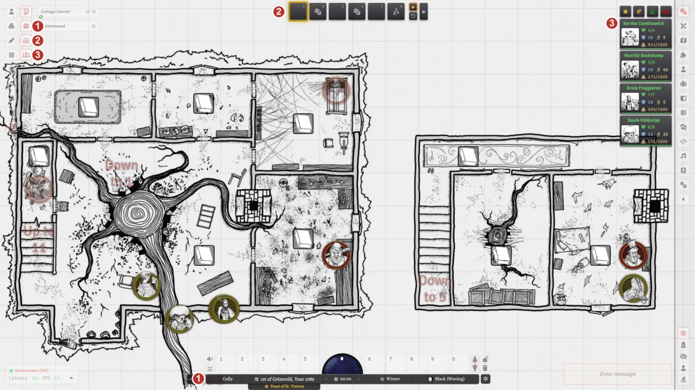

1. The calendar, above the hotbar.
2. The dungeon tracker, at the top of the screen.
3. The party viewer, on the right.

## Creating a character

- Create a new Actor of type *Adventurer*.
- On the *Stats* tab, choose a kindred and a class from the drop-downs. This adds them to the character from the Kindreds and Classes compendiums, along with their traits.
- Enter your ability scores, hit points and alignment.
- With the premium module, click the d20 next to the name or the background to roll on the kindred's name or background tables.
- Drag equipment, spells, glamours and runes from a compendium or the Items directory onto the sheet.

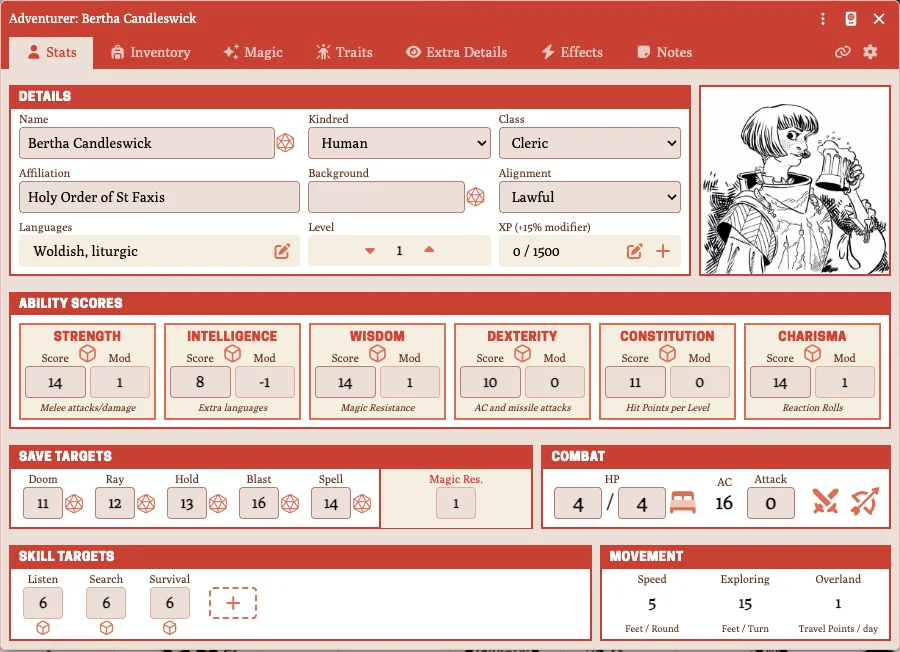

## Rolls

- Click the die next to an ability, save or skill on the *Stats* tab to roll it.
- Custom skills can be added to every adventurer with the *Custom Skills* setting (a comma-separated list), and then added to a character with the *+* next to the skill list.
- Journal text can include clickable rolls:
  - `[Save vs Doom](save:doom)` rolls a save for the selected tokens. The saves are `doom`, `ray`, `hold`, `blast` and `spell`.
  - `[2-in-6 to find it](chance:2)` rolls an X-in-6 chance.

## Experience and levels

- Click the *+* next to XP to add experience. The class's XP modifier is applied.
- When a character has enough XP, the level-up arrow lights up. Click it to go up a level. The new hit points are rolled and posted to chat.

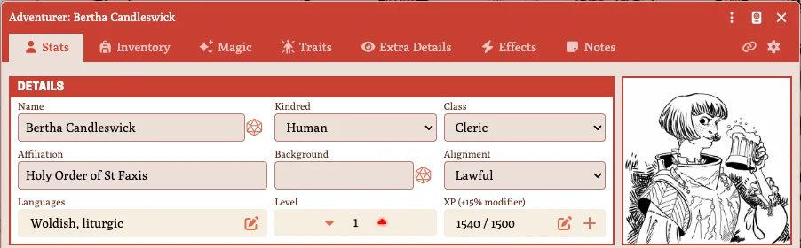

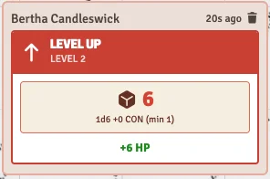

## Inventory and encumbrance

- Everything a character carries is on the *Inventory* tab with coins tracked in their own section.
- Items are either equipped or stowed. Use the icon on an item's row to move it between the two.
- The *Encumbrance Method* setting chooses how load is counted:
  - *Weight (Full)*: every item and coin counts.
  - *Weight (Treasure)*: only treasure counts, once it passes the *Significant Load* percentage.
  - *Slots*: items take slots, with *Coins Per Slot* coins to a slot.
  - *Disabled*: no encumbrance.
- Speed drops as load goes up. Exhaustion is tracked on the same tab.

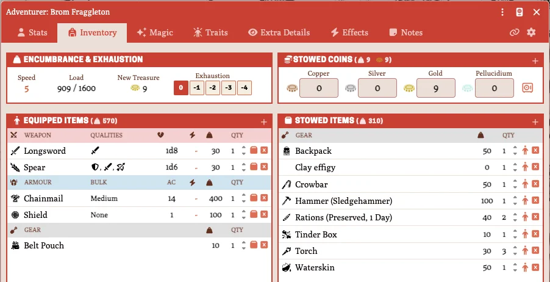

## Magic

- The *Magic* tab shows the kinds of magic the character's kindred and class can use: arcane spells, holy spells, fairy glamours and runes, and mossling knacks. A tab can also be switched on by hand, or by an effect.
- Drag spells onto the tab to learn them, then memorise (arcane) or prepare (holy) them into slots. Clicking a spell casts it and empties its slot.
- Holy spells granted at a shrine can be marked as a shrine spell, which needs no slot.
- Runes track their uses (once a day, once a week, and so on). Using a weekly or yearly rune adds a calendar note for the day it refreshes.

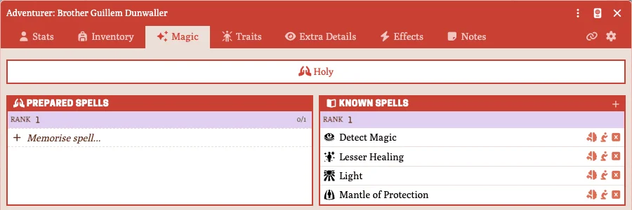

## Traits

The *Traits* tab lists the kindred's and class's traits. Traits with limited uses can be invoked from there, or shared to chat.

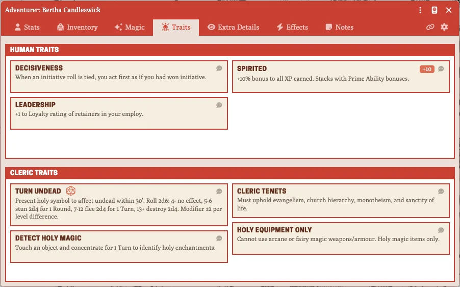

## Resting

Click the bed icon next to HP on the *Stats* tab to rest. An overnight rest restores 1 HP, and a full day of rest 1d3 HP. Resting also resets trait uses, and reminds spellcasters to memorise their spells.

## Combat

### Before combat

The Referee has four buttons at the top of the combat tracker:

- **Surprise Check:** rolls 1d6 for each side. A side is surprised on a 1–2.
- **Encounter Distance:** rolls 2d6 × 10 feet in a dungeon, or × 30 feet outdoors.
- **Reaction Roll:** rolls 2d6 plus a CHA modifier, and shows the monsters' reaction.
- **Morale Check:** rolls 2d6 against a morale score.

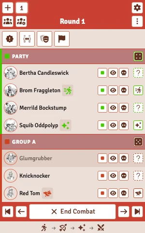

### Initiative

- Initiative is rolled by group, not by combatant. Friendly tokens join the *Party*, hostile tokens *Group A* and neutral tokens *Group D*. Use the group button on a combatant to move it to another group (Groups A–F).
- Roll a group's initiative with the die in its header. Players can roll for the party. Right-click the die to enter a roll by hand.
- The *Initiative Each Round* setting chooses what happens at the start of each round: keep the rolls, clear them (the default), or roll again.
- **Add Party to Combat** adds everyone in the party viewer to the tracker.

### Declarations

Before initiative, each combatant can declare what they're doing with the declaration button on their row: casting a spell, using a rune or glamour (*Magic*), or fleeing (*Flee*). The optional charge and parry declarations can be turned on with the *Optional Combat Rules* setting~~.~~

### Attacking

- Click the sword (melee) or bow (missile) next to *Attack* on the *Stats* tab. This opens the attack panel.
- Choose the weapon, the kind of attack (normal, charge or push), any modifiers (backstab, two weapons, and so on) and a bonus or penalty. Then roll attack and damage together, or only one of them.
- **Save as Macro** puts the attack, with all its options, on the hotbar.
- Target a token before attacking to roll against its AC. With *Auto-Calculate Missile Range* on, the range comes from the distance to the target.
- The damage card has buttons to apply the damage to the selected tokens: full, half, double, or adjusted for cold iron against fey. With *Auto-Apply Damage* on, a hit applies its damage to the target automatically.
- Creatures at 0 HP are marked defeated (*Auto-Mark as Defeated at 0 HP*) and added to the kill log (*Auto-Add to Kill Log*).

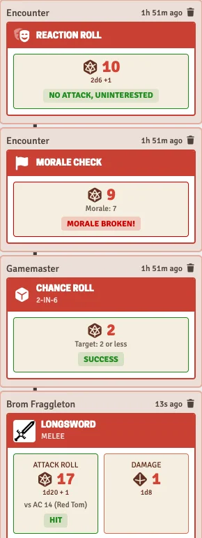

## Creatures

- Creature sheets have attacks, saves and morale. Click the morale icon to roll it.
- With *Randomize Creature HP* on, every unlinked token placed on a scene rolls its own hit points.
- **Import Statblock**, at the top of the Actors directory, turns a pasted Dolmenwood or OSE stat block into a Creature actor.
- Horses and vehicles have their own sheets.

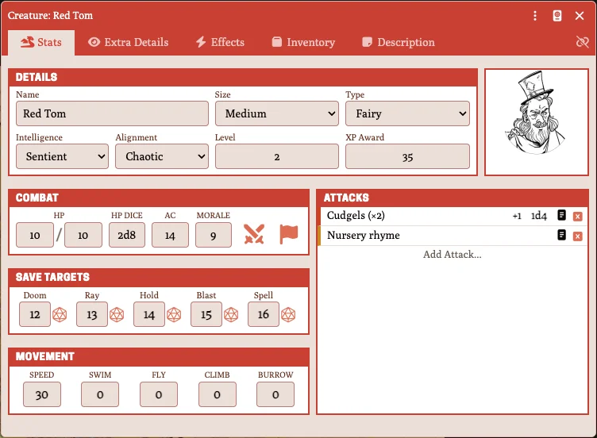

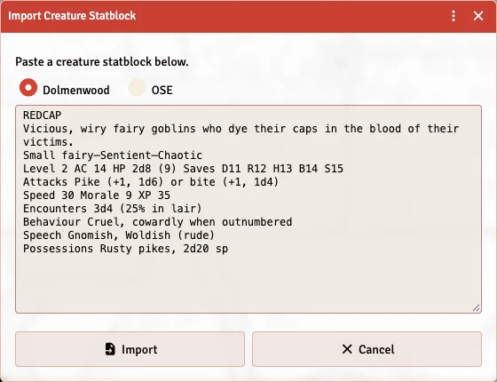

## Effects

- Adventurers and items have an *Effects* tab. An item's effects apply when it's equipped, or while it's carried.
- An effect can change ability scores, saves, AC, attack and damage, speed, skills, spell slots, encumbrance and the XP modifier.
- Effects can last a number of rounds, turns, hours or days, until a rest, until the next day, or for ever.
- An effect can have several parts. Use the arrows and *+* in the effect's details to move between them and add more.
- The *Advanced* mode can target any value on the character by its data path.

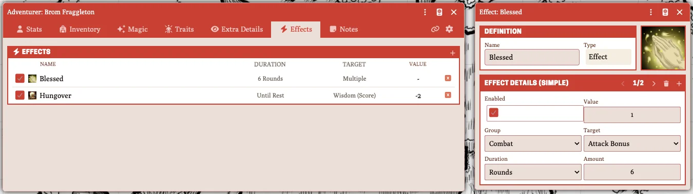

## The party viewer

- Turn it on with the party button on the Dolmenwood toolbar.
- Select tokens and click **Add Selected** to add them to the party.
- **Divide XP** splits experience between the party: an amount you enter, the party's new treasure, or the creatures in the kill log. Drop creatures onto it to add them to the log.
- **Divide Coins** splits coins between the party.
- Retainers take the XP and loot share set on their sheet's *Settings* tab.

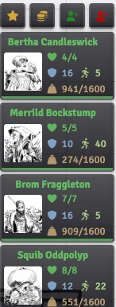

## The dungeon tracker

- Turn it on with the dungeon button on the Dolmenwood toolbar. It sits at the top of the screen and counts 10-minute turns as world time passes, or when you click **Next Turn**.
- In its settings, choose how often to check for wandering monsters, the chance (X in Y), an encounter table to roll on, and how often the party must rest.
- It tracks torches and lanterns as they burn down, and any other timers you add. A timer can be visible to everyone or to the Referee only.
- When a lot of time passes at once, such as after an overnight rest, it asks whether to clear, pause or process the missed turns.

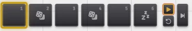

## The calendar

- Turn it on with the calendar button on the Dolmenwood toolbar. It sits above the hotbar.
- It shows the Dolmenwood date and time, with the day of the week, holidays, the moon, sunrise and sunset.
- The Referee can advance time by 10 minutes, an hour or 8 hours, set the date and time, and set the current unseason.
- **Roll Weather** rolls the season's weather, and its effects on travel. With *Auto Weather* on, the weather is rolled each day.
- Calendar notes can be added to any day, for everyone or for the Referee only, and can repeat weekly, monthly or yearly.

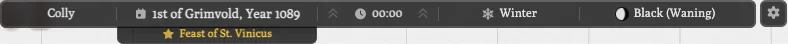

## Settings

- **Colour Theme:** a dozen themes inspired by the books, plus a high-contrast theme. *Apply Theme to Interface* also recolours Foundry's own interface. Both are set per player.
- **Hide Journal Art:** hides the books' artwork in the Dolmenwood journals. Set per player.
- **Show Welcome Message:** shows the welcome dialog on load.

The combat, encumbrance and creature settings are described in their sections above.

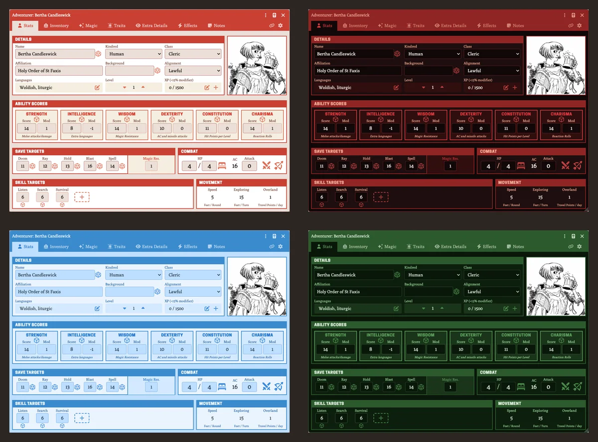

## Converting an OSE world

There are two macros in the `scripts` folder that export your OSE world content and import it into a Dolmenwood world.

1. In your OSE world, add and run [the export macro](https://github.com/NecroticGnome/dolmenwood-foundry-system/blob/main/scripts/ose-export-macro.js). It downloads a `.json` file.
2. In your Dolmenwood world, add and run [the import macro](https://github.com/NecroticGnome/dolmenwood-foundry-system/blob/main/scripts/ose-import-macro.js), and choose that file.

This converts the actors and items in your world to the Dolmenwood format, and imports its scenes and journals.

- The export only includes what's in your world, **not compendiums**. Import any compendium content you want to keep before exporting.
- Image paths are kept as they are, so removing the OSE system or its assets breaks the portraits and tokens of imported actors.

## For module and macro developers

### The API

The system exposes an API at `game.dolmenwood`, available from a module's `init` hook onward. 


| Member                                                   | Description                                                                                                           |
| -------------------------------------------------------- | --------------------------------------------------------------------------------------------------------------------- |
| `rollReaction(chaMod = 0)`                               | Rolls 2d6 + CHA modifier and posts it to chat. Returns `{ roll, total, category }`                                    |
| `rollSurprise()`                                         | Rolls 1d6 for each side (surprised on 1–2). Returns `{ friendly, hostile }`, each `{ roll, surprised }`               |
| `rollMoraleCheck(morale)`                                | Rolls 2d6 against a morale score. Returns `{ roll, morale, passed }`                                                  |
| `rollEncounterDistance(environment = 'dungeon')`         | Rolls 2d6 × 10 ft (`'dungeon'`) or × 30 ft (`'outdoors'`). Returns `{ roll, multiplier, distance }`                   |
| `rollChance(target)`                                     | Rolls an X-in-6 check (succeeds on `target` or less) and posts it to chat                                             |
| `rollSaveForControlled(saveKey, bonus = 0)`              | Rolls a save (`doom`, `ray`, `hold`, `blast`, `spell`) for each controlled token                                      |
| `getReactionCategory(total)`                             | The reaction for a 2d6 reaction total                                                                                 |
| `findRollTable(name, { quiet })`                         | Finds a roll table by name, in the world or a compendium                                                              |
| `drawFromTable(name)`                                    | Draws from a table by name and posts it to chat. Returns the result text, or `null`                                   |
| `drawFromTableSilent(name)`                              | Draws without a chat message. Returns the result text, or `null`                                                      |
| `worldTimeToCalendar(worldTime)`                         | Converts world time to `{ year, monthKey, monthIndex, day, dayOfYear, hour, minute }`                                 |
| `calendarToWorldTime(year, monthKey, day, hour, minute)` | Converts a date back to world time                                                                                    |
| `getSeason(monthKey)` / `getDaylightHours(monthKey)`     | The season, and the daylight hours, for a month                                                                       |
| `getDayName(monthKey, day)`                              | `{ name, isWysenday }`. A weekday key such as `'colly'`, or the wysenday's name                                       |
| `getHoliday(monthKey, day)`                              | The holiday's name, or `null`                                                                                         |
| `getMoonForDay(dayOfYear)`                               | `{ moon, phase, phaseIcon }`. `phaseIcon` is the filename of the system's moon art                                    |
| `importCreatureStatblock(text, format = 'dolmenwood')`   | Parses a stat block (`'dolmenwood'` or `'ose'`) and creates a Creature actor, which it returns                        |
| `openCreatureImportDialog()`                             | Opens the stat block import dialog. Resolves when the dialog closes                                                   |
| `getUnseason()`                                          | The active unseason's key, or `null`                                                                                  |
| `getWeather()`                                           | Today's weather: `{ text, effects, roll }`                                                                            |
| `executeMacroAttack(macro)`                              | Runs an attack macro saved from the attack panel. Called from the macro as `game.dolmenwood.executeMacroAttack(this)` |
| `isReady`                                                | `true` once the system has finished its ready work                                                                    |


For example, a macro that rolls a save vs Doom for the selected tokens:

```js
game.dolmenwood.rollSaveForControlled('doom')
```

### The `dolmenwood.ready` hook

Foundry doesn't wait for async `ready` handlers, so a module's `ready` hook can run before the system has finished preparing its data. When it's done, the system sets `game.dolmenwood.isReady` and fires `dolmenwood.ready`, with `game.dolmenwood` as the argument.

```js
Hooks.once('dolmenwood.ready', async api => {
  const table = await api.findRollTable('Wandering Monsters')
  if (table) await table.draw()
})
```

### Adding tools to the Dolmenwood toolbar

- **`CONFIG.DOLMENWOOD.extraTools`:** tools that don't change. Set them once in your module's `init` hook.
- **The `getDolmenwoodTools` hook:** called with the toolbar's tools each time it renders. Use it for tools that depend on current state, such as a toggle's `active` value or a permission check.

```js
// A button that doesn't change
Hooks.once('init', () => {
  CONFIG.DOLMENWOOD.extraTools.myTool = {
    name: 'myTool', title: 'My Tool', icon: 'fa-solid fa-star',
    button: true, onChange: () => {}
  }
})

// A toggle that reflects a setting
Hooks.on('getDolmenwoodTools', tools => {
  tools.myToggle = {
    name: 'myToggle', title: 'My Toggle', icon: 'fa-solid fa-eye', toggle: true,
    active: game.settings.get('my-module', 'enabled'),
    onChange: (event, active) => game.settings.set('my-module', 'enabled', active)
  }
})
```